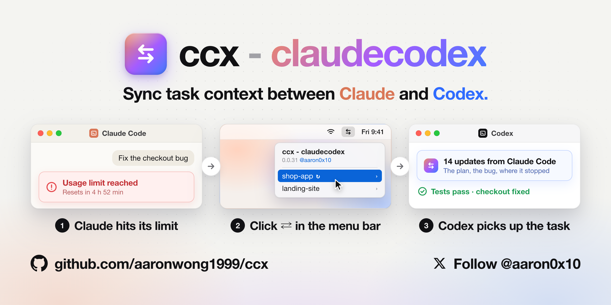

<h1 align="center">ccx - claudecodex</h1>

<p align="center">
  <b>Hit your Claude Code limit, or stuck on a bug? Let the other agent take over with the full context, then switch back.</b><br>
  Claude Code 额度用完了，或者卡在某个问题上？带着完整上下文交给另一个 agent 接着干，搞定再切回来。
</p>

<p align="center">
  <a href="https://github.com/aaronwong1999/ccx/stargazers"></a>
  <a href="https://x.com/aaron0x10"></a>
  <a href="LICENSE"></a>
  <br>
  <sub>Built by <a href="https://x.com/aaron0x10"><b>Aaron (@aaron0x10)</b></a>, who also made <a href="https://github.com/AaronWong1999/hermesclaw">HermesClaw</a> (featured in the official <a href="https://github.com/NousResearch/hermes-agent">Hermes Agent</a> README).</sub>
</p>

<p align="center">
  
</p>
<p align="center">
  <a href="https://github.com/user-attachments/assets/515f88d4-9b50-4b0d-ad6c-8485409a99d3"><b>🎬 Watch 30 second demo，观看 30 秒演示视频</b></a>
</p>

## Why ccx · 为什么需要它

| | Without ccx · 没有 ccx | With ccx · 有了 ccx |
|---|---|---|
| Usage limit hit<br>额度用完 | Wait for the 5-hour reset<br>干等 5 小时恢复 | Continue in the other app<br>切到另一个 app 继续干 |
| Stuck on a problem<br>卡在某个问题上 | Keep retrying the same agent, or paste everything over by hand<br>在同一个 agent 上反复重试，或手动把来龙去脉贴过去 | Let the other agent take a shot, already up to speed<br>换另一个 agent 试试，它已经了解来龙去脉 |
| Switching apps<br>换 app | Re-explain all context<br>重新解释全部上下文 | The other side already knows<br>对面已经知道进展 |
| Coming back<br>切回来 | Start a new chat<br>新开对话 | Same conversation, same progress<br>原来的对话，同样的进展 |

ccx links a Claude Code session with a Codex thread and keeps them in sync in both directions, inside both **desktop apps**, with a ⇄ menu bar icon for one-click switching. Everything runs on your Mac: no account, no server, no telemetry.<br>
ccx 把一个 Claude Code 会话和一个 Codex 线程关联起来，在两个**桌面版** app 里双向同步，菜单栏 ⇄ 图标一点就能切换。全部在你的 Mac 上运行：不用注册、没有服务器、不收集数据。

## Install · 安装

**The easy way:** paste this into Claude Code or Codex, and it installs ccx for you.<br>
**最简单：** 把下面这段话贴给 Claude Code 或 Codex，它会帮你装好 ccx。

```
Install ccx for me: run `curl -fsSL https://raw.githubusercontent.com/aaronwong1999/ccx/main/install.sh | sh` (it needs network access and writes to my home folder), then run `~/.local/bin/ccx doctor` and tell me the result.
```

**Or run it yourself** in Terminal.<br>
**或者自己在终端运行：**

```bash
curl -fsSL https://raw.githubusercontent.com/aaronwong1999/ccx/main/install.sh | sh
```

**You need** a Mac with macOS 13 or later and the [Claude](https://claude.com/download) and/or [Codex](https://openai.com/codex) desktop app.<br>
**需要：** macOS 13 及以上的 Mac，以及 [Claude](https://claude.com/download) 桌面版和/或 [Codex](https://openai.com/codex) 桌面版（Codex / ChatGPT 桌面版）。

<details>
<summary><b>What you may be asked · 安装时可能出现的确认</b></summary>

| When · 时机 | What you see · 你会看到 | What to do · 怎么做 |
|---|---|---|
| Installing through Claude Code or Codex<br>让 Claude Code 或 Codex 帮你安装 | The app asks to run the command; Codex may ask to run it outside the sandbox or with network access.<br>app 询问是否运行这条命令；Codex 可能询问是否在沙盒外运行或允许联网 | Allow it.<br>允许 |
| Apple's Command Line Tools are missing (git, python3, swiftc)<br>缺少苹果命令行工具 | A macOS window: "The xcode-select command requires the command line developer tools".<br>macOS 弹窗："xcode-select 命令需要命令行开发者工具" | Click **Install**, accept the license, wait 5–10 minutes, then run the install command again.<br>点**安装**、同意许可，等 5–10 分钟后再运行一次安装命令 |
| The menu bar icon is set to start at login<br>菜单栏图标设为登录时启动 | A macOS notice: "Background Items Added".<br>macOS 通知："已添加后台项目" | Nothing; keep it on (System Settings → General → Login Items).<br>不用管，保持开启（系统设置 → 通用 → 登录项） |
| ccx shows a result or update notice<br>ccx 显示同步结果或更新提示 | A request to allow notifications (may show as "Script Editor").<br>请求允许通知（可能显示为"脚本编辑器"） | Allow, so you see sync results.<br>允许，这样能看到同步结果 |
| ccx opens a project in Codex for the first time<br>ccx 第一次在 Codex 里打开某个项目 | Codex: "Trust this folder?"<br>Codex："信任此文件夹吗？" | Trust it if it's your project; this is Codex's own check.<br>是你自己的项目就信任；这是 Codex 自己的检查 |

Nothing else asks for passwords, admin rights or accessibility access.<br>
除此之外，不会要求密码、管理员权限或辅助功能权限。
</details>

<details>
<summary><b>What the installer does · 安装脚本做了什么</b></summary>

1. Checks macOS, the desktop apps and Apple's Command Line Tools; with neither app installed it stops and changes nothing.<br>检查系统版本、两个桌面版和苹果命令行工具；两个 app 都没装就停下，不做任何改动。
2. Downloads the newest release of ccx to `~/Library/Application Support/ccx`.<br>把 ccx 的最新正式版下载到 `~/Library/Application Support/ccx`。
3. Installs the ccx plugin into Claude and Codex from that copy. Its prompt hook brings the other side's new progress into a linked conversation whenever you send a message, and never blocks a message.<br>用这份副本把 ccx 插件装进 Claude 和 Codex。它的 hook 在已关联的对话里每发一条消息就带入对面的新进展，从不拦截消息。
4. Turns that hook on in Codex, which asks for every third-party hook to be approved; the installer approves ccx's own hook and only that one.<br>在 Codex 里启用这个 hook：Codex 要求手动批准第三方 hook，安装脚本只批准 ccx 自己的这一个。
5. Builds the ⇄ menu bar icon on your Mac (nothing downloaded needs a signature) and starts it at login.<br>在本机编译菜单栏 ⇄ 图标（不下载任何需要签名的程序），并设为登录时启动。
6. Adds a `ccx` command in `~/.local/bin`, and puts that folder on your PATH in `~/.zprofile` if needed.<br>在 `~/.local/bin` 加一个 `ccx` 命令，必要时把这个目录写进 `~/.zprofile` 的 PATH。
</details>

<details>
<summary><b>If something's missing · 缺东西时会怎样</b></summary>

- **Only one app installed:** ccx sets that one up; install the other later and the menu bar icon finishes setup by itself.<br>**只装了一个 app：** 先装好这一个；之后装上另一个，菜单栏图标会自动补装。
- **Claude installed but Code never opened:** open Claude and click **Code** once; ccx then finishes setup by itself.<br>**装了 Claude 但没点过 Code：** 打开 Claude 点一次 **Code**，ccx 会自动补装。
- **Installed ccx from a plugin directory:** run the install command anyway to add the ⇄ menu bar and the other app's side. It keeps the plugin you already have and never installs a second copy.<br>**从插件目录装过 ccx：** 照样运行安装命令，补上菜单栏 ⇄ 和另一个 app 那一半。它会沿用你已经装好的插件，不会再装第二份。
- **Neither app:** the installer stops with download links and changes nothing.<br>**两个都没装：** 安装脚本给出下载链接后停下，不做任何改动。
- **Anything else:** `ccx doctor` lists what's missing, `ccx setup` repairs, and re-running the install command is always safe.<br>**其他情况：** `ccx doctor` 列出缺什么，`ccx setup` 修复，重复运行安装命令总是安全的。
</details>

## Use · 使用

| You want to · 你想 | Do this · 怎么做 |
|---|---|
| Claude ran out; continue in Codex<br>Claude 额度用完，到 Codex 接着干 | Click ⇄ → project → session. Or in a new Codex conversation say **"continue the ‹name› session from Claude"**, or paste a screenshot and say "continue this".<br>点 ⇄ → 项目 → 会话。或者在 Codex 新开对话说<b>"从 Claude 把 ‹名称› 那个会话导入，接着干"</b>，也可以贴截图说"接着这个干" |
| Codex ran out too; back to Claude<br>Codex 也用完了，回到 Claude | Open the **same** Claude conversation and send anything ("continue"); Codex's progress comes in.<br>打开**原来那个** Claude 对话随便说一句（比如"继续"），Codex 的进展会自动带进来 |
| Back to Codex again<br>再回到 Codex | Open the same Codex conversation and send anything.<br>打开原来那个 Codex 对话，随便说一句 |
| One side is stuck; let the other try<br>一边卡住了，让另一边试试 | Same switch: click ⇄, or `/to-codex` · `$to-claude`. Once it's solved, open the original conversation and send anything; the fix comes back with it.<br>一样的切换：点 ⇄，或者 `/to-codex` · `$to-claude`。搞定后打开原来的对话随便说一句，解决过程会一起带回来 |
| Pull progress now<br>立刻同步一下 | Claude: `/from-codex` · Codex: `$from-claude` |
| Hand this conversation over<br>把当前对话交给另一边 | Claude: `/to-codex` · Codex: `$to-claude` · or click ⇄ · 或点 ⇄ |

The ⇄ menu lists recent projects and both sides' sessions: ○ not linked yet (click to import and link), ✓ linked (click to open the partner), ↻ has progress the other side hasn't received. English or Chinese via Language / 语言.<br>
⇄ 菜单按项目列出两边的会话：○ 未关联（点一下导入并关联），✓ 已关联（点一下打开对面），↻ 有对面还没收到的新进展。可在 Language / 语言 里切换中英文。

**Optional: a heads-up before either side runs out.** If you already use [CodexBar](https://github.com/steipete/CodexBar), [Claude Code Usage Monitor](https://github.com/Maciek-roboblog/Claude-Code-Usage-Monitor) or [ccusage](https://github.com/ccusage/ccusage), ccx finds it and reads its documented output: `codexbar usage --format json` (Claude and Codex), claude-monitor's state file (`--write-state`) or `--once --output json`, and `ccusage blocks --json`. When Claude's or Codex's 5-hour window passes 90%, and again when it is used up, you get one notification, and the top of the ⇄ menu offers that side's newest session to continue in the other app in one click. Nothing to set up; ccx never estimates usage itself and never interrupts a conversation, and without these tools nothing changes. Check it with `ccx usage`.<br>
**可选：任一边额度快用完时提前提醒。** 装了 [CodexBar](https://github.com/steipete/CodexBar)、[Claude Code Usage Monitor](https://github.com/Maciek-roboblog/Claude-Code-Usage-Monitor) 或 [ccusage](https://github.com/ccusage/ccusage) 时，ccx 自动读取：Claude 或 Codex 的 5 小时额度用到 90% 和用完时各通知一次，⇄ 菜单顶部可一键把那边最新的会话切到另一边接着干；无需设置，没装则一切照旧。

## FAQ · 常见问题

**Is my code or conversation uploaded anywhere?** No. Sync runs entirely on your Mac; Codex data goes only through Codex's own app-server API. ccx reaches GitHub only to install and check for updates.<br>
**会把我的代码或对话上传到哪里吗？** 不会。同步完全在本机进行；Codex 的数据只通过 Codex 自己的 app-server 接口读写。ccx 只在安装和检查更新时访问 GitHub。

**Does it bypass usage limits?** No. You use your own Claude and ChatGPT/Codex plans, each within its own limits; ccx only moves the task between them.<br>
**这是在绕过额度限制吗？** 不是。你用的是自己的 Claude 和 ChatGPT/Codex 订阅，各自在各自的额度内；ccx 只是在两边之间搬运任务。

**Windows, Linux, or the standalone CLIs?** Not yet: ccx needs macOS 13+ and the Claude and/or Codex desktop apps (it uses the CLIs those apps bundle).<br>
**支持 Windows、Linux 或单独的命令行版吗？** 暂时不支持：ccx 需要 macOS 13+ 以及 Claude 和/或 Codex 桌面版（它用的是这两个 app 自带的命令行工具）。

<details>
<summary><b>More questions · 更多问题</b></summary>

**What exactly is carried over?** Every user message and reply, condensed tool calls and output, the latest task list (Claude's todos or Codex's plan), a note when the other side stopped mid-step, your unfinished `/goal`, pasted images (as the path of the app's own cached copy), and `git status`. The code is already on your disk. It arrives as context for the model, not as new chat bubbles; a very long first handover keeps the most recent ~60k characters plus every request, and the model can page through the rest with `read_session`. ccx never sets a `/goal` for you: when one is unfinished, the result window puts the `/goal …` command on your clipboard.<br>
**具体会带过去什么？** 所有用户消息和回复、压缩后的工具调用和输出、最新任务清单（Claude 的待办或 Codex 的计划）、对面是否停在某一步中间、未完成的 `/goal`、你贴的图片（以该 app 自己缓存的路径），以及 `git status`。代码本来就在你的磁盘上。这些内容作为上下文交给模型，不会变成新的聊天气泡；很长的会话第一次交接时保留最近约 6 万字符和你所有的提问，其余部分模型可以用 `read_session` 补读。ccx 从不替你设置 `/goal`：有未完成的目标时，结果弹窗会把 `/goal …` 指令放到剪贴板。

**How much usage does a transfer cost? Does clicking again send everything again?** Each update is delivered once, usually a few thousand tokens; clicking again with nothing new says **already in sync** and adds nothing. The real cost is elsewhere: a very long conversation that sat idle for over an hour has lost its prompt cache, so the next message there re-reads all of it. Before a long import or a resume like that, the menu shows both numbers (for example ~215k for a full import vs ~25k for a new, linked conversation with the condensed progress) and lets you choose. In either app, choosing a new conversation opens the right project with the continuation prompt already in the input box. The success dialog confirms it is filled in; dismiss it and send the prompt yourself. This step doesn't use your clipboard. ccx never interrupts a conversation you simply keep using, and it recognizes Claude Code's own compaction.<br>
**传输一次花多少额度？重复点击会不会再发一遍？** 每条进展只送一次，通常几千 token；没有新内容时再点会显示**已同步**，不追加任何东西。真正的成本在别处：一个很长的对话闲置一个多小时后缓存过期，下一条消息会把它整个重读一遍。遇到这种长导入或长对话，菜单会先把两个数字列出来（例如完整导入约 215k，新开一个带压缩进展的关联对话约 25k），由你来选。两个方向选择新开对话后，都会在对应项目中直接填好接着干的指令；成功弹窗会提示已填好，关闭后由你自己点击发送。这一步不占用剪贴板。你在自己的对话里正常继续时，ccx 从不打断；它也能识别 Claude Code 自己的压缩。

**Do I have to close an app first?** No. Sync only adds context to the conversation you're in.<br>
**要先关掉某个 app 吗？** 不用。同步只是往当前对话里加上下文。

**Behind a proxy, for example in mainland China?** ccx reaches GitHub only to install and to check for updates (every 3 hours, with `git`); syncing itself is entirely local. It uses a proxy from your environment, or else the system proxy set in System Settings → Network (what Clash and similar apps set), including for the menu bar app, which has no terminal environment. If GitHub is unreachable, the check just fails quietly and runs again later.<br>
**在代理环境下（比如中国大陆）能用吗？** ccx 只在安装和检查更新时访问 GitHub（每 3 小时一次，用 `git`），同步本身完全在本机进行。它会使用环境变量里的代理；没有的话，就用系统设置 → 网络里的系统代理（Clash 等工具设置的就是这个），菜单栏程序没有终端环境，也同样适用。如果连不上 GitHub，这次检查会静默失败，之后再试。

**What if the two sides work in different folders?** ccx says so, and the model asks whether to switch folders or use the progress as reference. For two worktrees of one repo it shows both branches.<br>
**两边的工作目录不一样怎么办？** ccx 会写明这一点，模型会先问你：切换到那个目录接着干，还是只拿来参考。同一个仓库的两个 worktree 还会显示两边的分支。

**An imported Codex conversation isn't under its project, or shows "Retry" on older history?** ccx files each imported thread under its project in the Codex sidebar, and runs Codex's own history migration so older turns open. If Codex still has that thread open, the repair waits until you quit Codex (the menu shows "History repair pending"); `ccx repair` retries by hand. ccx never kills Codex or edits its database.<br>
**导入到 Codex 的对话没归到项目下，或者旧消息一直显示"重试"？** ccx 会把导入的对话归到 Codex 侧边栏对应的项目下，并调用 Codex 自带的历史迁移让旧消息能展开。如果 Codex 正开着那个对话，修复会等你退出 Codex 后进行（菜单显示"历史修复待完成"）；也可以运行 `ccx repair` 手动重试。ccx 从不强行关闭 Codex，也不改它的数据库。
</details>

## How it works · 原理

```
 Claude desktop                                  Codex desktop
 ┌──────────────────────┐                      ┌──────────────────────┐
 │ ccx plugin            │                      │ ccx plugin            │
 │  · skills /from-codex │                      │  · skills $from-claude│
 │  · MCP tools          │──┐              ┌────│  · MCP tools          │
 │  · prompt hook        │  │              │    │  · prompt hook        │
 └──────────────────────┘  │              │    └──────────────────────┘
      reads ~/.claude/projects/*.jsonl    Codex app-server API (thread/list,
                           │              │    thread/read, session import)
                           ▼              ▼
              ~/.ccx/pairs.json  (A ↔ T, and how far each side has been delivered)
                           ▲
                 ⇄ menu bar app and `ccx` CLI (same code)
```

A Claude session A and a Codex thread T form a pair, and each side keeps a cursor of how much the other side has received. When you send a message in A, the prompt hook adds T's new progress to that message and moves the cursor, to avoid repeatedly forwarding the same entries. This is a best-effort context handoff; the model can page through anything omitted with `read_session`. Saying "continue X from …" links the conversation you're in to X; the menu bar and `/to-…` use the apps' native import instead. Session titles are searched across all projects, so a typed name or a screenshot is enough.<br>
Claude 会话 A 和 Codex 线程 T 组成一对，两边各记一个"对面已经收到多少"的位置。你在 A 里发消息时，hook 会把 T 的新进展加到这条消息里，然后移动位置。这样可以避免重复转发同一批记录。这是尽力而为的上下文交接，省略的内容模型可以用 `read_session` 补读。在对话里说"从 … 接着 X 干"，会把当前对话和 X 关联起来；菜单栏和 `/to-…` 则用两个 app 自带的导入功能。会话标题会在所有项目里搜索，所以说出名称或给一张截图就够了。

## Updates · 更新

When a new release is published (checked every 3 hours), the ⇄ app installs it automatically and notifies you. You can switch this off in the menu, and then you get a notification and an "Update to x.y.z" item instead. `ccx update` does the same by hand.<br>
GitHub 上发布新版本后（每 3 小时检查一次），⇄ 菜单栏程序会自动安装并通知你。可以在菜单里关掉自动安装，关掉后只会收到通知，菜单里出现"更新到 x.y.z"。手动更新用 `ccx update`。

## Uninstall · 卸载

```bash
ccx uninstall          # remove the plugins, menu bar icon and `ccx` command · 移除插件、菜单栏图标和 ccx 命令
ccx uninstall --purge  # also delete link records in ~/.ccx · 同时删除 ~/.ccx 里的关联记录
```

## Development · 开发

```bash
git clone https://github.com/aaronwong1999/ccx && cd ccx
./install.sh --dev                      # install the plugin from this checkout · 从本地目录安装插件
python3 -m unittest discover -s tests   # needs neither Claude nor Codex · 不需要 Claude 或 Codex
```

`plugins/ccx/` is the plugin, with both a `.claude-plugin` and a `.codex-plugin` manifest; `lib/ccx/` is the core in standard-library Python 3.9+. `menubar/` is the Swift menu bar app. Releases: [docs/RELEASING.md](docs/RELEASING.md).<br>
`plugins/ccx/` 是插件本体，同时带有 `.claude-plugin` 和 `.codex-plugin` 两套清单；`lib/ccx/` 是核心代码，只用 Python 3.9+ 标准库。`menubar/` 是 Swift 写的菜单栏程序。发布流程见 [docs/RELEASING.md](docs/RELEASING.md)。

---

<p align="center">
  <b>If ccx saved you a 5-hour wait, help the next person find it.</b><br>
  如果 ccx 帮你省下了 5 小时的等待，帮下一个人也找到它。
</p>

<p align="center">
  <a href="https://github.com/aaronwong1999/ccx/stargazers"><b>⭐ Star on GitHub · 点个 Star</b></a> ·
  <a href="https://x.com/aaron0x10"><b>Follow @aaron0x10 · 关注获取更新</b></a> ·
  <a href="https://x.com/intent/post?text=Hit%20your%20Claude%20Code%20limit%3F%20ccx%20hands%20the%20task%20to%20Codex%20with%20full%20context%2C%20one%20click%20from%20the%20menu%20bar.&url=https%3A%2F%2Fgithub.com%2Faaronwong1999%2Fccx"><b>Share on X · 分享到 X</b></a>
</p>

<p align="center">
  Feedback and ideas are welcome on X (<a href="https://x.com/aaron0x10">@aaron0x10</a>) or in <a href="https://github.com/aaronwong1999/ccx/issues">Issues</a>.<br>
  欢迎在 X（<a href="https://x.com/aaron0x10">@aaron0x10</a>）或 <a href="https://github.com/aaronwong1999/ccx/issues">Issues</a> 反馈和提建议。
</p>

<p align="center"><sub>MIT license · MIT 许可. ccx is an independent open-source project, not affiliated with Anthropic or OpenAI. "Claude", "Claude Code" and "Codex" are trademarks of their owners.<br>ccx 是独立的开源项目，与 Anthropic 和 OpenAI 无关；"Claude"、"Claude Code" 和 "Codex" 是其各自所有者的商标。</sub></p>
