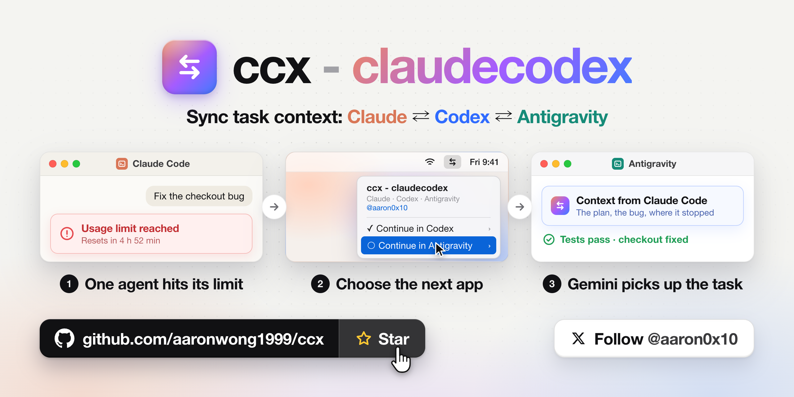

<h1 align="center">ccx - claudecodex</h1>

<p align="center">
  <br>
  <b>Now with Antigravity: switch between Claude Code, Codex and Antigravity, in any direction.</b><br>
  <b>新增 Antigravity 支持：Claude Code、Codex、Antigravity 三个现在可以互相切换。</b>
</p>

<p align="center">
  <b>Hit a limit in Claude Code, Codex or Antigravity? Hand the task to another agent with its context, then switch back.</b><br>
  Claude Code、Codex 或 Antigravity 额度用完了？带着上下文换一个 agent 接着干，随时再切回来。
</p>

<p align="center">
  <a href="https://github.com/aaronwong1999/ccx/stargazers"></a>
  <a href="https://x.com/aaron0x10"></a>
  <a href="LICENSE"></a>
  <br>
  <sub>Built by <a href="https://x.com/aaron0x10"><b>Aaron (@aaron0x10)</b></a>, who also made <a href="https://github.com/AaronWong1999/hermesclaw">HermesClaw</a> (featured in the official <a href="https://github.com/NousResearch/hermes-agent">Hermes Agent</a> README).</sub>
</p>

<p align="center">
  
</p>
<p align="center">
  <a href="https://github.com/user-attachments/assets/6dc89886-d055-4cdc-97ad-a3edc97386e1"><b>🎬 Watch 30 second demo · 看 30 秒演示</b></a>
</p>

## Why ccx · 为什么需要它

| | Without ccx · 没有 ccx | With ccx · 有了 ccx |
|---|---|---|
| Usage limit hit<br>额度用完 | Wait for usage to reset<br>干等额度恢复 | Continue in either of the other two apps<br>切到另外两个 app 中的任一个继续干 |
| Stuck on a problem<br>卡在某个问题上 | Keep retrying the same agent, or paste everything over by hand<br>在同一个 agent 上反复重试，或手动把来龙去脉贴过去 | Let the other agent take a shot, already up to speed<br>换另一个 agent 试试，它已经了解来龙去脉 |
| Try Gemini in Antigravity<br>想让 Antigravity 里的 Gemini 试试 | Start over or paste the whole task history<br>从头解释，或手动复制整个任务记录 | Bring the task from Claude or Codex, ready to continue<br>把 Claude 或 Codex 的任务带过去，接着干 |
| Switching apps<br>换 app | Re-explain all context<br>重新解释全部上下文 | The next agent already has the context<br>下一个 agent 已经了解进展 |
| Coming back<br>切回来 | Start a new chat<br>新开对话 | Same conversation, same progress<br>原来的对话，同样的进展 |

ccx connects **Claude Code, Codex and Antigravity** on your Mac. Move a task between their **desktop apps** with the ⇄ menu, keeping the conversation, plan and progress together. First time: import and link. Next time: continue the linked conversation with new progress. No ccx account, server or telemetry.<br>
ccx 把 Mac 上的 **Claude Code、Codex 和 Antigravity** 连起来。通过菜单栏 ⇄ 在三个**桌面版**之间接力，对话、计划和进展一起带过去。第一次导入并关联，之后回到关联的对话就能带入新进展。不需要 ccx 账号、服务器，也不收集数据。

### Claude, Codex and Antigravity · 三家接力

Gemini’s latest models make **[Antigravity](https://antigravity.google/docs/models)** another strong coding option alongside Claude Code and Codex. Want Gemini to tackle the bug, or has one app hit its limit? Hand over the task with its context instead of starting over. Claude → Codex → Antigravity → back again: use the agent and quota available to you, and keep the same task moving.<br>
Gemini 的新模型让 **[Antigravity](https://antigravity.google/docs/models)** 成为 Claude Code 和 Codex 之外的又一个强力编程选择。想让 Gemini 换个思路解题，或者哪一家额度用完了？把任务连同上下文交过去，不必从头解释。Claude → Codex → Antigravity → 再切回来：哪边还有额度、哪边更适合，就让哪边接着干。

```
        Claude Code
         ⇄       ⇄
     Codex   ⇄   Antigravity
```

- **Nothing to turn on.** Once you have opened Antigravity on your Mac, ccx sets itself up there and the ⇄ menu shows three apps; without it, ccx is the same two-app tool as before.<br>**不用开任何开关。** 安装并打开过 Antigravity 后，ccx 会自己装进去，⇄ 菜单变成三个 app；没装，ccx 和以前的双 app 版本完全一样。
- **⇄ → project → session → “Continue in …”.** Each target shows its state: ○ first time (imports and links), ✓ linked and in sync, ↻ linked with new progress to bring.<br>**⇄ → 项目 → 会话 → “去 … 接着干”。** 每个去向都标着状态：○ 首次（导入并关联），✓ 已关联且已同步，↻ 已关联、有新进展待带入。
- **In a conversation:** `/to-antigravity` · `/from-antigravity` in Claude, `$to-antigravity` · `$from-antigravity` in Codex, and “continue the ‹name› session from Claude / Codex” in Antigravity.<br>**在对话里：** Claude 里用 `/to-antigravity` · `/from-antigravity`，Codex 里用 `$to-antigravity` · `$from-antigravity`，Antigravity 里说“从 Claude / Codex 把 ‹名称› 那个会话导入，接着干”。

<details>
<summary><b>Antigravity handoff details · Antigravity 交接细节</b></summary>

- **Two things Antigravity does differently.** It can't take history into a conversation, so a task sent there starts a new Antigravity conversation whose first message is the condensed conversation; Antigravity answers that once, with a single line. And it has no link that opens one conversation, so ccx opens the app and tells you which conversation it is (titled `⇄ …`, under the project).<br>**Antigravity 有两点不一样。** 它不能往对话里写入历史，所以传过去的任务会新开一个 Antigravity 对话，第一条消息是压缩后的对话内容，Antigravity 会回复一行确认。它也没有“打开某个对话”的链接，所以 ccx 打开 app 后会告诉你是哪一个（标题带 `⇄`，在对应项目下）。
- **How it reads Antigravity.** Titles, folders and sync state come from Antigravity's own summary database and work with the app closed. A conversation's content is read through the app's local service, so ccx starts Antigravity in the background when it needs to read one.<br>**怎么读取 Antigravity。** 标题、目录和同步状态来自 Antigravity 自己的摘要数据库，app 关着也能读。对话内容通过 app 的本机服务读取，所以需要读某个对话而 Antigravity 没开时，ccx 会在后台把它启动。

</details>

### Project folder permissions · 项目目录权限

On first launch, ccx offers a macOS folder picker: select where your projects live. It saves folder bookmarks and restores them on later launches. If you declined a system prompt, choose **⇄ → Project Folder Access…** to select folders or open **Privacy & Security → Files and Folders**, then refresh. ccx never repeatedly opens its permission wizard from the background; Full Disk Access is not required. Each coding app has its own permissions. Because this release is locally built and ad-hoc signed, macOS may ask again after an update; preserving privacy grants reliably across versions requires a stable Developer ID signature.

首次启动时，ccx 会引导你用系统目录选择器选取项目目录，并保存目录书签，后续启动自动恢复。如果拒绝过系统弹窗，可从 **⇄ → 项目目录权限…** 重新选择目录，或打开 **隐私与安全性 → 文件与文件夹** 修改权限，再点刷新。授权向导不会在后台反复弹出，无需完全磁盘访问。各 coding app 的权限独立。这版仍在本机编译并临时签名，更新后 macOS 可能重新询问；跨版本可靠保留授权需要固定的 Developer ID 签名。

## Install · 安装

**The easy way:** paste this into Claude Code, Codex or Antigravity, and it installs ccx for you.<br>
**最简单：** 把下面这段话贴给 Claude Code、Codex 或 Antigravity，它会帮你装好 ccx。

```
Install ccx for me: run `curl -fsSL https://raw.githubusercontent.com/aaronwong1999/ccx/main/install.sh | sh` (it needs network access and writes to my home folder), then run `~/.local/bin/ccx doctor` and tell me the result.
```

**Or run it yourself** in Terminal.<br>
**或者自己在终端运行：**

```bash
curl -fsSL https://raw.githubusercontent.com/aaronwong1999/ccx/main/install.sh | sh
```

**Only the Claude Code plugin** (the skills and sync inside Claude Code; run the install command above later to add ⇄ and the Codex / Antigravity sides):<br>
**只装 Claude Code 插件**（Claude Code 里的 skill 和同步；之后运行上面的安装命令即可补上 ⇄ 和 Codex / Antigravity 端）：

```
/plugin install ccx --marketplace AaronWong1999/ccx
```

Before Claude Code 2.1.275: `/plugin marketplace add AaronWong1999/ccx`, then `/plugin install ccx@ccx`.<br>
Claude Code 2.1.275 之前的版本：先 `/plugin marketplace add AaronWong1999/ccx`，再 `/plugin install ccx@ccx`。

**You need** macOS 13+ and at least two of the desktop apps: [Claude](https://claude.com/download), [Codex](https://openai.com/codex), [Antigravity](https://antigravity.google). Pick any two, or use all three. Open each app and sign in first; in Claude, open **Code** once. If only one is installed, ccx sets it up and connects the others when you add them.<br>
**需要：** macOS 13+，以及以下桌面版中至少两个：[Claude](https://claude.com/download)、[Codex](https://openai.com/codex)、[Antigravity](https://antigravity.google)。任意两个都能互通，三个也可以全用。先分别打开并登录；Claude 里需点开一次 **Code**。只装了一个也可以先安装 ccx，之后添加其他 app 时会自动补上。

<details>
<summary><b>What you may be asked · 安装时可能出现的确认</b></summary>

| When · 时机 | What you see · 你会看到 | What to do · 怎么做 |
|---|---|---|
| Installing through Claude Code, Codex or Antigravity<br>让 Claude Code、Codex 或 Antigravity 帮你安装 | The app asks to run the command; Codex may ask to run it outside the sandbox or with network access.<br>app 询问是否运行这条命令；Codex 可能询问是否在沙盒外运行或允许联网 | Allow it.<br>允许 |
| Apple's Command Line Tools are missing (git, python3, swiftc)<br>缺少苹果命令行工具 | A macOS window: "The xcode-select command requires the command line developer tools".<br>macOS 弹窗："xcode-select 命令需要命令行开发者工具" | Click **Install**, accept the license, wait 5–10 minutes, then run the install command again.<br>点**安装**、同意许可，等 5–10 分钟后再运行一次安装命令 |
| The menu bar icon is set to start at login<br>菜单栏图标设为登录时启动 | A macOS notice: "Background Items Added".<br>macOS 通知："已添加后台项目" | Nothing; keep it on (System Settings → General → Login Items).<br>不用管，保持开启（系统设置 → 通用 → 登录项） |
| Projects live in Desktop, Documents or Downloads<br>项目放在桌面、文稿或下载目录 | macOS asks ccx for folder access.<br>macOS 询问是否允许 ccx 访问对应目录 | Allow the folders you use. To recover after a denial: **⇄ → Project Folder Access…**.<br>允许使用的目录；拒绝后可从 **⇄ → 项目目录权限…** 恢复 |
| ccx shows a result or update notice<br>ccx 显示同步结果或更新提示 | A request to allow notifications (may show as "Script Editor").<br>请求允许通知（可能显示为"脚本编辑器"） | Allow, so you see sync results.<br>允许，这样能看到同步结果 |
| ccx opens a project in Codex for the first time<br>ccx 第一次在 Codex 里打开某个项目 | Codex: "Trust this folder?"<br>Codex："信任此文件夹吗？" | Trust it if it's your project; this is Codex's own check.<br>是你自己的项目就信任；这是 Codex 自己的检查 |

Nothing else asks for passwords, admin rights or accessibility access.<br>
除此之外，不会要求密码、管理员权限或辅助功能权限。
</details>

<details>
<summary><b>What the installer does · 安装脚本做了什么</b></summary>

1. Checks macOS, the desktop apps and Apple's Command Line Tools; with none of the three apps installed it stops and changes nothing.<br>检查系统版本、三个桌面版和苹果命令行工具；三个 app 都没装就停下，不做任何改动。
2. Downloads the newest release of ccx to `~/Library/Application Support/ccx`.<br>把 ccx 的最新正式版下载到 `~/Library/Application Support/ccx`。
3. Installs the ccx plugin into the apps you have: Claude, Codex and Antigravity. Their hooks bring linked conversations' new progress into the app you continue in.<br>用这份副本把 ccx 插件装进你已有的 Claude、Codex 和 Antigravity；各自的 hook 会在你继续对话时带入已关联会话的新进展。
4. Turns that hook on in Codex, which asks for every third-party hook to be approved; the installer approves ccx's own hook and only that one.<br>在 Codex 里启用这个 hook：Codex 要求手动批准第三方 hook，安装脚本只批准 ccx 自己的这一个。
5. Builds the ⇄ menu bar icon on your Mac (nothing downloaded needs a signature) and starts it at login.<br>在本机编译菜单栏 ⇄ 图标（不下载任何需要签名的程序），并设为登录时启动。
6. Adds a `ccx` command in `~/.local/bin`, and puts that folder on your PATH in `~/.zprofile` if needed.<br>在 `~/.local/bin` 加一个 `ccx` 命令，必要时把这个目录写进 `~/.zprofile` 的 PATH。
</details>

<details>
<summary><b>If something's missing · 缺东西时会怎样</b></summary>

- **Only one app installed:** ccx sets that one up; install another later and the menu bar icon finishes setup by itself.<br>**只装了一个 app：** 先装好这一个；之后装上其他 app，菜单栏图标会自动补装。
- **Claude installed but Code never opened:** open Claude and click **Code** once; ccx then finishes setup by itself.<br>**装了 Claude 但没点过 Code：** 打开 Claude 点一次 **Code**，ccx 会自动补装。
- **Installed ccx from a plugin directory:** run the install command anyway to add the ⇄ menu bar and the other apps' sides. It keeps the plugin you already have and never installs a second copy.<br>**从插件目录装过 ccx：** 照样运行安装命令，补上菜单栏 ⇄ 和其他 app 端。它会沿用你已经装好的插件，不会再装第二份。
- **None of the three apps:** the installer stops with download links and changes nothing.<br>**三个都没装：** 安装脚本给出下载链接后停下，不做任何改动。
- **Anything else:** `ccx doctor` lists what's missing, `ccx setup` repairs, and re-running the install command retries setup without deleting conversations or links.<br>**其他情况：** `ccx doctor` 列出缺什么，`ccx setup` 修复，重复运行安装命令会重试设置，不会删除对话和关联。
</details>

## Use · 使用

| You want to · 你想 | Do this · 怎么做 |
|---|---|
| Any app hit its limit<br>任意一家额度用完 | Click **⇄ → project → session → Continue in …**, then choose either of the other apps.<br>点 **⇄ → 项目 → 会话 → 去 … 接着干**，选择另外两个 app 中的任一个 |
| Try Gemini on the same task<br>让 Gemini 接着同一个任务试试 | In Claude or Codex, choose **Continue in Antigravity**; or use `/to-antigravity` in Claude and `$to-antigravity` in Codex.<br>在 Claude 或 Codex 的会话下选 **去 Antigravity 接着干**；也可用 Claude 的 `/to-antigravity` 或 Codex 的 `$to-antigravity` |
| Antigravity hit its limit; move back<br>Antigravity 也用完了，换回来 | Choose its session in ⇄ → **Continue in Claude / Codex**, or say “continue in Claude / Codex” inside Antigravity.<br>在 ⇄ 里选它的会话 → **去 Claude / Codex 接着干**；也可在 Antigravity 里说“转给 Claude / Codex 继续” |
| Return to an app you used before<br>回到之前用过的 app | Open its **linked conversation** and send “continue”; the others’ new progress comes along.<br>打开它**已关联的对话**，发一句“继续”，另外两边的新进展会一起带进来 |
| One agent is stuck; try another<br>一个 agent 卡住了，换个思路 | Make the same switch. Once solved, return to the original linked conversation; the solution comes back with it.<br>用同样的方法切换。解决后回到原来关联的对话，解决过程会一起带回来 |
| Bring another app’s task into this conversation<br>把别处的任务带进当前对话 | Say **“continue the ‹name› session from Claude / Codex / Antigravity”**, or paste a screenshot of the session.<br>说 **“从 Claude / Codex / Antigravity 把 ‹名称› 那个会话导入，接着干”**，也可以贴会话截图 |
| Pull or send with a skill<br>用指令拉取或转交 | Claude: `/from-codex`, `/to-codex`, `/from-antigravity`, `/to-antigravity`. Codex: `$from-claude`, `$to-claude`, `$from-antigravity`, `$to-antigravity`. In Antigravity, ask to continue from or switch to Claude / Codex.<br>Claude 和 Codex 中用相应指令；Antigravity 中直接说从 Claude / Codex 接着干，或转给它们 |

The ⇄ menu groups conversations by project and app. Choose a session, then a destination: ○ first import and link, ✓ linked and in sync, ↻ linked with new progress to bring on the next message there. Each destination has its own state. English or Chinese via Language / 语言.<br>
⇄ 菜单按项目和 app 列出会话。先选会话，再选去向：○ 首次导入并关联，✓ 已关联、已同步，↻ 已关联、在那边发下一条消息时会带入新进展。每个去向都有自己的状态，可在 Language / 语言 里切换中英文。

**Unlink · 取消关联:** to stop two conversations syncing, pick ⇄ → the project → **Unlink**, or say "unlink" in either one. Both conversations are kept; handing over again links them afresh.<br>
要让两个对话不再同步，在 ⇄ → 项目 → **取消关联** 里选它们，或在任一边说“取消关联”。两边对话都保留，再次切换会重新关联。<br>
**Cloud sessions · 云端会话:** Claude Code on the web sessions and Codex Cloud tasks show up with ☁ under the project that checks out their GitHub repository (others under **Other Cloud Sessions**). The menu lists titles only; clicking one reads just that conversation, through the app's own CLI and sign-in, and links it like any other. Cloud sessions only come down to your Mac: a Claude cloud session's new progress reaches Codex or Antigravity with your next message there, and handing that Codex conversation back makes a local Claude conversation (ccx never writes to the cloud). From a Codex Cloud task, Claude gets its status and code change (not applied; the Codex CLI doesn't expose a task's messages). If you only signed in to the Claude desktop app, pick **Show Claude Cloud Sessions (Sign In Once)…**: after a short explanation, Claude Code's own sign-in opens in your browser, usually a single click, and only once.<br>
Claude 网页版的云端会话和 Codex Cloud 任务会带着 ☁ 出现在检出了对应 GitHub 仓库的项目下（其余的在 **其他云端会话** 里）。菜单只列标题；点哪个才通过该 app 自己的命令行和登录读取哪个，并像普通会话一样关联。云端只往本机传：Claude 云端会话的新进展会在你下次给 Codex 或 Antigravity 发消息时带过去；把那个 Codex 对话再传回来，会变成一个本机的 Claude 对话（ccx 从不往云端写）。Codex Cloud 任务带给 Claude 的是状态和代码改动（不会自动应用；Codex 命令行不提供任务的对话内容）。如果你只在 Claude 桌面版里登录过，点 **显示 Claude 云端会话（需登录一次）…**：先看到一段说明，再在浏览器里完成 Claude Code 自己的登录，通常点一下就好，只需一次。

**Usage heads-up for all three apps.** The top of the ⇄ menu shows Claude's, Codex's and Antigravity's 5-hour usage side by side. The app notifies you once when one passes 90% and once when it is used up, and offers that side's newest session to continue in one click in whichever app has the most room left. Nothing to set up; it never interrupts a conversation. Check it with `ccx usage`.<br>
**三家额度一眼看全，快用完时提前提醒。** ⇄ 菜单顶部并排显示 Claude、Codex、Antigravity 的 5 小时额度。哪家用到 90% 和用完时各通知一次，并可一键把那边最新的会话切到剩余额度最多的那一家接着干，无需任何设置。

### Works with · 搭配使用

Built in: Codex's own numbers (its app-server's `account/rateLimits/read`), Antigravity's own numbers (its local service's quota summary for the Gemini models, read while Antigravity is open; the last reading is kept while it is closed), and Claude Code's "You've hit your limit · resets …" reply. Claude keeps no local signal before that, so for a warning before Claude runs out, ccx also reads what these tools print or keep on disk when they are installed. It only reads, and never estimates usage itself:

| Tool | What ccx reads | What you get |
|---|---|---|
| [CodexBar](https://github.com/steipete/CodexBar) | `codexbar usage --provider both --format json` | Claude's and Codex's 5-hour windows |
| [abtop](https://github.com/graykode/abtop) | `rate_limits` in `abtop --json` (Claude's after `abtop --setup`) | Claude's and Codex's 5-hour windows |
| [claude-hud](https://github.com/jarrodwatts/claude-hud) | the snapshot it writes for other tools (`display.externalUsageWritePath`) | Claude's 5-hour and weekly windows, from Claude Code itself |
| [Claude Status Bar](https://github.com/leeguooooo/claude-code-usage-bar) | the status line input it saves, `~/.cache/claude-statusbar/last_stdin.json` | Claude's 5-hour and weekly windows, from Claude Code itself |
| [magpie](https://github.com/yetone/magpie) | `magpie quota claude codex --json`, for the Claude account Claude Code is signed in to | Claude's (and, without the Codex app, Codex's) 5-hour and weekly windows |
| [Agent Sessions](https://github.com/jazzyalex/agent-sessions) | the Claude snapshot its usage meter saves, `~/Library/Application Support/com.triada.AgentSessions/claude_usage_latest.json` | Claude's 5-hour and weekly windows |
| [ccstatusline](https://github.com/sirmalloc/ccstatusline) | its usage cache, `~/.cache/ccstatusline/usage.json` (written only when it calls the usage API itself, not while Claude Code's own rate limits cover its widgets) | Claude's 5-hour and weekly windows |
| [CCometixLine](https://github.com/Haleclipse/CCometixLine) | its usage cache, `~/.claude/ccline/.api_usage_cache.json` | Claude's 5-hour window |
| [Claude Code Usage Monitor](https://github.com/Maciek-roboblog/Claude-Code-Usage-Monitor) | its `--write-state` file, or `claude-monitor --once --output json` | Claude's 5-hour window, near and used up |
| [ccusage](https://github.com/ccusage/ccusage) | `ccusage blocks --json --token-limit max` | a heads-up when the current block is on pace to pass your largest one |

内置读取 Codex 和 Antigravity 自己报告的额度，以及 Claude Code 的撞限提示；装了上面任一工具时，Claude 快用完也会提前提醒。

Using [CloudCLI](https://github.com/siteboon/claudecodeui)? The [ccx plugin](https://github.com/AaronWong1999/cloudcli-plugin-ccx) adds a tab for Claude / Codex usage and hands the open session between those two apps.<br>
用 CloudCLI？[ccx 插件](https://github.com/AaronWong1999/cloudcli-plugin-ccx) 加一个标签页：显示 Claude / Codex 的额度，并在这两个 app 之间转交当前会话。

Using [magpie](https://github.com/yetone/magpie)? This repository is also a magpie plugin: in magpie, open Plugins › Discover › Unofficial and add **ccx**, or run `magpie plugin add aaronwong1999/ccx`. Every agent magpie connects then gets `ccx_sessions` and `ccx_read`, so another agent or model can read a Claude Code, Codex or Antigravity conversation and carry on the task.<br>
用 [magpie](https://github.com/yetone/magpie)？这个仓库本身也是 magpie 插件：在 magpie 的「插件 › 发现 › 非官方」里添加 **ccx**，或运行 `magpie plugin add aaronwong1999/ccx`。之后 magpie 接的每个 agent 都能读 Claude Code、Codex 或 Antigravity 的对话，换个 agent 或模型也能接着干。

## FAQ · 常见问题

**Does ccx upload my code or conversation to its own service?** No. Sync runs on your Mac; Codex data goes only through Codex's own app-server API. Cloud sessions are read by Claude Code's and Codex's own CLIs with their own sign-in; ccx does not handle their sign-in. Antigravity is read and written through its own local service and its `agentapi` command; a task you send to Antigravity becomes a message in your own Antigravity conversation, like one you typed. The receiving coding app uses its own model service as usual. ccx itself reaches GitHub only to install and check for updates.<br>
**ccx 会把代码或对话传到自己的服务吗？** 不会。同步在本机进行；Codex 的数据只通过 Codex 自己的 app-server 接口读写。云端会话由 Claude Code 和 Codex 自己的命令行用它们自己的登录读取，ccx 不接管这些 app 的登录。Antigravity 通过它自己的本机服务和 `agentapi` 命令读写；你传到 Antigravity 的任务会成为你自己 Antigravity 对话里的一条消息，和你手动输入的一样。接收任务的 coding app 仍像平常一样调用自己的模型服务。ccx 本身只在安装和检查更新时访问 GitHub。

**Does it bypass usage limits?** No. You use your own Claude, ChatGPT/Codex and Antigravity accounts, each within its own limits; ccx only moves the task between them.<br>
**这是在绕过额度限制吗？** 不是。你用的是自己的 Claude、ChatGPT/Codex 和 Antigravity 账号，各自在各自的额度内；ccx 只是在三者之间搬运任务。

**Windows, Linux, or the standalone CLIs?** Not yet: ccx needs macOS 13+ and at least two supported desktop apps: Claude, Codex and Antigravity. It uses their local data and bundled services; standalone CLI-only setups are not supported.<br>
**支持 Windows、Linux 或单独的命令行版吗？** 暂时不支持：ccx 需要 macOS 13+，以及 Claude、Codex、Antigravity 三个桌面版中的至少两个；它使用这些 app 的本机数据和内置服务，暂不支持只装独立 CLI 的组合。

<details>
<summary><b>More questions · 更多问题</b></summary>

**What exactly is carried over?** Every user message and reply, condensed tool calls and output, the latest task list (Claude's todos or Codex's plan), a note when the other side stopped mid-step, your unfinished `/goal`, pasted images (as the path of the app's own cached copy), and `git status`. The code is already on your disk. It arrives as context for the model, not as new chat bubbles; a very long first handover keeps the most recent ~60k characters plus every request, and the model can page through the rest with `read_session`. ccx never sets a `/goal` for you: when one is unfinished, the result window puts the `/goal …` command on your clipboard.<br>
**具体会带过去什么？** 所有用户消息和回复、压缩后的工具调用和输出、最新任务清单（Claude 的待办或 Codex 的计划）、对面是否停在某一步中间、未完成的 `/goal`、你贴的图片（以该 app 自己缓存的路径），以及 `git status`。代码本来就在你的磁盘上。这些内容作为上下文交给模型，不会变成新的聊天气泡；很长的会话第一次交接时保留最近约 6 万字符和你所有的提问，其余部分模型可以用 `read_session` 补读。ccx 从不替你设置 `/goal`：有未完成的目标时，结果弹窗会把 `/goal …` 指令放到剪贴板。

**How much usage does a transfer cost? Does clicking again send everything again?** Each update is delivered once, usually a few thousand tokens; clicking again with nothing new says **already in sync** and adds nothing. The real cost is elsewhere: a very long conversation that sat idle for over an hour has lost its prompt cache, so the next message there re-reads all of it. Before a long import or a resume like that, the menu shows both numbers (for example ~215k for a full import vs ~25k for a new, linked conversation with the condensed progress) and lets you choose. Between Claude and Codex, choosing a new conversation opens the right project with the continuation prompt already in the input box. The success dialog confirms it is filled in; dismiss it and send the prompt yourself. This step doesn't use your clipboard. ccx never interrupts a conversation you simply keep using, and it recognizes Claude Code's own compaction.<br>
**传输一次花多少额度？重复点击会不会再发一遍？** 每条进展只送一次，通常几千 token；没有新内容时再点会显示**已同步**，不追加任何东西。真正的成本在别处：一个很长的对话闲置一个多小时后缓存过期，下一条消息会把它整个重读一遍。遇到这种长导入或长对话，菜单会先把两个数字列出来（例如完整导入约 215k，新开一个带压缩进展的关联对话约 25k），由你来选。在 Claude 和 Codex 之间选择新开对话后，都会在对应项目中直接填好接着干的指令；成功弹窗会提示已填好，关闭后由你自己点击发送。这一步不占用剪贴板。你在自己的对话里正常继续时，ccx 从不打断；它也能识别 Claude Code 自己的压缩。

**Do I have to close an app first?** No. Sync only adds context to the conversation you're in.<br>
**要先关掉某个 app 吗？** 不用。同步只是往当前对话里加上下文。

**Behind a proxy, for example in mainland China?** ccx reaches GitHub only to install and to check for updates (every 3 hours, with `git`); syncing itself is entirely local. It uses a proxy from your environment, or else the system proxy set in System Settings → Network (what Clash and similar apps set), including for the menu bar app, which has no terminal environment. If GitHub is unreachable, the check just fails quietly and runs again later.<br>
**在代理环境下（比如中国大陆）能用吗？** ccx 只在安装和检查更新时访问 GitHub（每 3 小时一次，用 `git`），同步本身完全在本机进行。它会使用环境变量里的代理；没有的话，就用系统设置 → 网络里的系统代理（Clash 等工具设置的就是这个），菜单栏程序没有终端环境，也同样适用。如果连不上 GitHub，这次检查会静默失败，之后再试。

**What if the two sides work in different folders?** ccx says so, and the model asks whether to switch folders or use the progress as reference. For two worktrees of one repo it shows both branches.<br>
**两边的工作目录不一样怎么办？** ccx 会写明这一点，模型会先问你：切换到那个目录接着干，还是只拿来参考。同一个仓库的两个 worktree 还会显示两边的分支。

**An imported Codex conversation isn't under its project, or shows "Retry" on older history?** ccx files each imported thread under its project in the Codex sidebar, and runs Codex's own history migration so older turns open. If Codex still has that thread open, the repair waits until you quit Codex (the menu shows "History repair pending"); `ccx repair` retries by hand. ccx never kills Codex or edits its database.<br>
**导入到 Codex 的对话没归到项目下，或者旧消息一直显示"重试"？** ccx 会把导入的对话归到 Codex 侧边栏对应的项目下，并调用 Codex 自带的历史迁移让旧消息能展开。如果 Codex 正开着那个对话，修复会等你退出 Codex 后进行（菜单显示"历史修复待完成"）；也可以运行 `ccx repair` 手动重试。ccx 从不强行关闭 Codex，也不改它的数据库。
</details>

## How it works · 原理

```
 Claude Code              Codex                   Antigravity
 plugin + MCP + hook      plugin + MCP + hook     plugin + MCP + hook
 local session files      app-server API          local service + agentapi
        \                     |                     /
         \____________________|____________________/
                              |
                  ~/.ccx/pairs.json
               links + per-destination cursors
                              |
                   ⇄ menu bar + ccx CLI
```

Each pair of linked conversations keeps track of how much each has received from the other. Add the third app and ccx fills in the remaining links, so each destination gets new progress without resending what it already has. Your next message triggers the sync. Saying “continue X from …” links the conversation you are in to X; the ⇄ menu imports and links it in the chosen app. Claude and Codex use native session imports; Antigravity starts with a condensed context message. Long history is condensed, and `read_session` can page through the rest.<br>
每对关联的会话都记录“对面已经收到多少”。第三个 app 加入时，ccx 会补齐其余关联，让每个去向收到新进展，已收到的不重复发送。你发下一条消息时触发同步。说“从 … 接着 X 干”，会关联当前对话；⇄ 菜单则在选定的 app 里导入并关联。Claude 和 Codex 走原生会话导入，Antigravity 用一条压缩后的上下文消息开始。较长的历史会被压缩，其余内容可通过 `read_session` 分页补读。

## Updates · 更新

When a new release is published (checked every 3 hours), the ⇄ app installs it automatically and notifies you. You can switch this off in the menu, and then you get a notification and an "Update to x.y.z" item instead. `ccx update` does the same by hand.<br>
GitHub 上发布新版本后（每 3 小时检查一次），⇄ 菜单栏程序会自动安装并通知你。可以在菜单里关掉自动安装，关掉后只会收到通知，菜单里出现"更新到 x.y.z"。手动更新用 `ccx update`。

## Uninstall · 卸载

```bash
ccx uninstall          # remove the plugins, menu bar icon and `ccx` command · 移除插件、菜单栏图标和 ccx 命令
ccx uninstall --purge  # also delete link records in ~/.ccx · 同时删除 ~/.ccx 里的关联记录
```

## Development · 开发

```bash
git clone https://github.com/aaronwong1999/ccx && cd ccx
./install.sh --dev                      # install the plugin from this checkout · 从本地目录安装插件
python3 -m unittest discover -s tests   # needs none of the apps · 不需要安装任何一个 app
```

`plugins/ccx/` is the plugin, with both a `.claude-plugin` and a `.codex-plugin` manifest; `lib/ccx/` is the core in standard-library Python 3.9+, including the Antigravity adapter and plugin installer. `menubar/` is the Swift menu bar app. Releases: [docs/RELEASING.md](docs/RELEASING.md).<br>
`plugins/ccx/` 是插件本体，同时带有 `.claude-plugin` 和 `.codex-plugin` 两套清单；`lib/ccx/` 是核心代码，含 Antigravity 适配器和插件安装逻辑，只用 Python 3.9+ 标准库。`menubar/` 是 Swift 写的菜单栏程序。发布流程见 [docs/RELEASING.md](docs/RELEASING.md)。

---

<p align="center">
  <b>If ccx kept your task moving, help the next person find it.</b><br>
  如果 ccx 帮你把任务接着做下去了，帮下一个人也找到它。
</p>

<p align="center">
  <a href="https://github.com/aaronwong1999/ccx/stargazers"><b>⭐ Star on GitHub · 点个 Star</b></a> ·
  <a href="https://x.com/aaron0x10"><b>Follow @aaron0x10 · 关注获取更新</b></a> ·
  <a href="https://x.com/intent/post?text=Claude%20Code%2C%20Codex%20or%20Antigravity%20hit%20its%20limit%3F%20ccx%20hands%20the%20task%20to%20another%20agent%20with%20the%20context%20intact.%20Keep%20going%20with%20Claude%2C%20OpenAI%20or%20Gemini.&url=https%3A%2F%2Fgithub.com%2Faaronwong1999%2Fccx"><b>Share on X · 分享到 X</b></a>
</p>

<p align="center">
  Feedback and ideas are welcome on X (<a href="https://x.com/aaron0x10">@aaron0x10</a>) or in <a href="https://github.com/aaronwong1999/ccx/issues">Issues</a>.<br>
  欢迎在 X（<a href="https://x.com/aaron0x10">@aaron0x10</a>）或 <a href="https://github.com/aaronwong1999/ccx/issues">Issues</a> 反馈和提建议。
</p>

<p align="center"><sub>MIT license · MIT 许可. ccx is an independent open-source project, not affiliated with Anthropic, OpenAI or Google. "Claude", "Claude Code", "Codex" and "Antigravity" are trademarks of their owners.<br>ccx 是独立的开源项目，与 Anthropic、OpenAI 和 Google 无关；"Claude"、"Claude Code"、"Codex" 和 "Antigravity" 是其各自所有者的商标。</sub></p>
